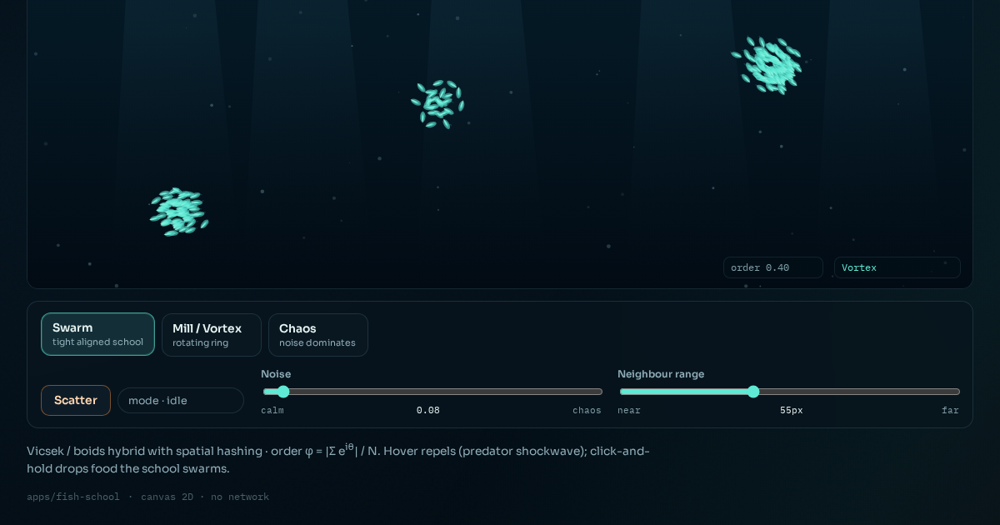

# Fish school

Vicsek-style collective motion — noise and neighbour range flip a school from chaos to a vortex or an aligned swarm.



**Live demo:** https://interesting-x.scorpion-labs.com/fish-school/

Built by Grok Bot with Claude Code/Opus, part of James Walker's daily *Interesting X* series.

## Run locally

```bash
npm install
npm run dev      # then open the printed URL (served under /fish-school/)
npm run build    # static output in dist/
```

## Notes


Live Vicsek / boids collective motion — a few hundred glowing fish that align,
attract, and avoid, flipping between chaos, a tightly aligned swarm, and a
rotating vortex as noise and neighbour range change.

Inspired by [Statistical Physics of Fish Collective Motion](https://x.com/DynamicsSIAM/status/2105193064771821938)
(@DynamicsSIAM, arXiv 2609.37637).

```bash
npm install
npm run dev -w @tech-demos/fish-school
```

Open `http://127.0.0.1:43129/fish-school/`.

## License

MIT © 2026 James Walker
